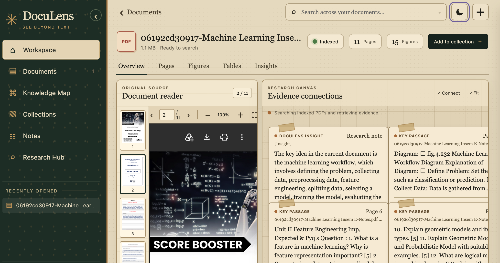
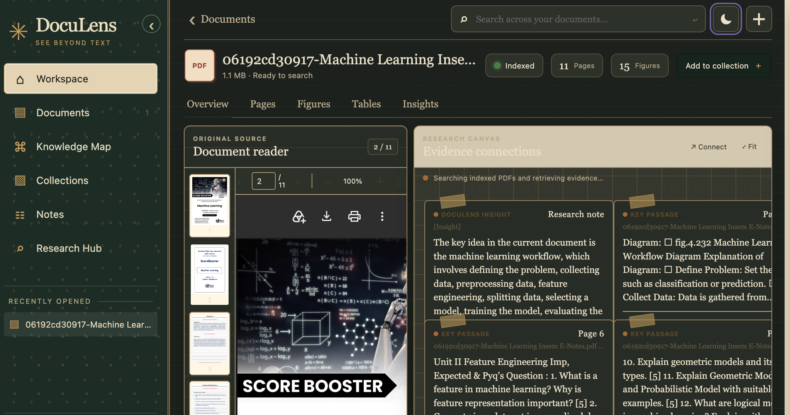
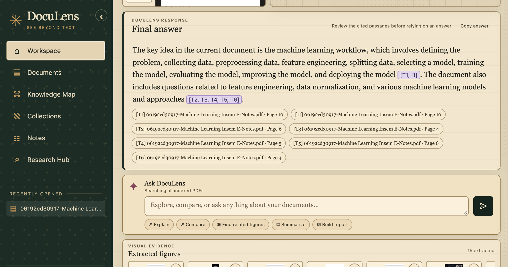
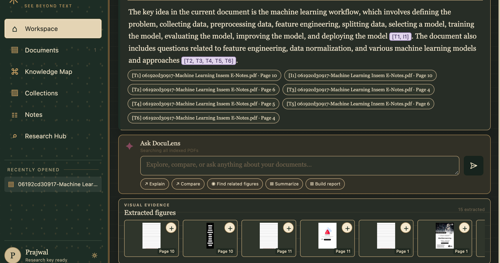
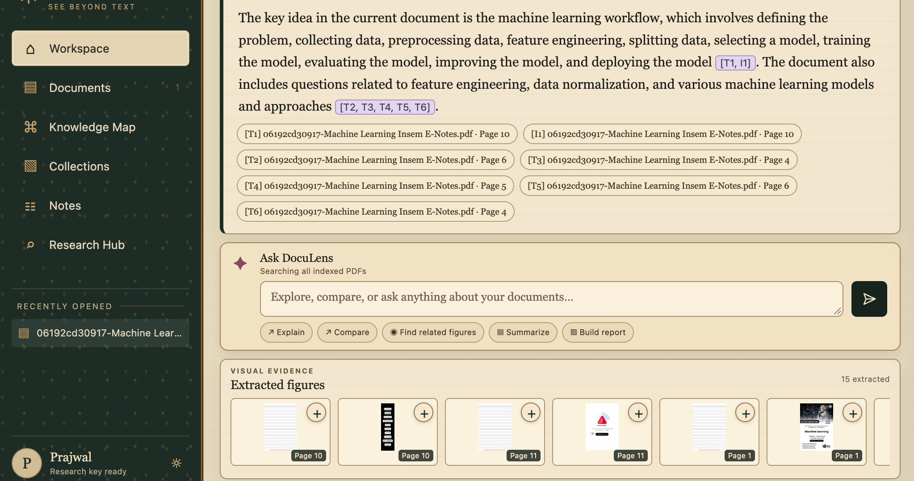

# DocuLens — Multimodal RAG for PDF Research

DocuLens is a multimodal retrieval-augmented generation (RAG) workspace for exploring PDF documents. Ask questions in natural language, get a synthesized answer, and follow its citations back to the source document and page.

## Features

- **Multimodal PDF ingestion:** upload PDFs from the browser (up to 25 MB), extract page text and embedded images, and index them for search.
- **Semantic text retrieval:** split extracted text into overlapping chunks, retain document/page metadata, and retrieve relevant passages by meaning.
- **Visual retrieval:** encode extracted figures with CLIP and search for related images alongside text evidence.
- **Grounded answers:** generate answers from retrieved context, label text and image sources, and show citations with document names and page numbers.
- **Evidence workspace:** view the original PDF beside passage and figure cards, navigate to source pages, and inspect extracted figures.
- **Research tools:** compare or summarize documents, find related figures, build reports, and save notes or collections in the browser.
- **Local-first workflow:** run the interface and keep uploaded PDFs, extracted images, and vector indexes on your machine.

Selecting evidence can guide retrieval toward it, while questions still search all indexed PDFs. Citation checks help connect answer claims to retrieved sources, but users should review cited passages in context.

The web app is a lightweight Python HTTP server with browser-side HTML, CSS, and JavaScript. It runs locally at `http://127.0.0.1:8000` by default. Collections and notes are saved in that browser's local storage. The current table view is a placeholder; table extraction is not implemented.

## Technology stack

| Layer | Technologies |
| --- | --- |
| Language and environment | Python 3.12+, `uv` |
| Browser interface | HTML, CSS, vanilla JavaScript |
| Local web server | Python standard-library HTTP server |
| PDF processing | PyMuPDF, pypdf |
| RAG orchestration and splitting | LangChain, LangChain Text Splitters |
| Text embeddings and answer model | OpenRouter through LangChain OpenAI integration (`openai/text-embedding-3-small`; `google/gemini-2.5-flash` by default) |
| Vector storage | Chroma via LangChain Chroma |
| Image embeddings | CLIP via Transformers and PyTorch; Pillow for image handling |
| Tests | pytest |

## Screenshots

### Document workspace

| Light theme | Dark theme |
| --- | --- |
|  |  |

### Cited answers

| Light theme | Dark theme |
| --- | --- |
|  |  |



## Requirements

- Python 3.12 or newer
- [`uv`](https://docs.astral.sh/uv/)
- An [OpenRouter API key](https://openrouter.ai/)

## Quick start

From the repository root:

```sh
uv sync
cp .env.example .env
```

Add your OpenRouter key to `.env`:

```dotenv
OPENROUTER_API_KEY=your-key-here
# Optional; defaults to google/gemini-2.5-flash
OPENROUTER_MODEL=google/gemini-2.5-flash
```

Start DocuLens:

```sh
uv run python web_ui.py
```

Open `http://127.0.0.1:8000`, upload a PDF, and wait for indexing to finish before asking questions. The server binds to localhost by default; set `RAG_UI_PORT` to choose another port. Keep `.env` private; it is excluded by `.gitignore`.

## Index the bundled sample

The repository includes *Attention Is All You Need* at `data/pdfs/attention-is-all-you-need.pdf`. Build the text and image indexes with:

```sh
uv run python -m multimodal_rag.rebuild_text_db
uv run python -m multimodal_rag.rebuild_image_db
```

Indexes and extracted images are generated locally and are not committed. The app uses separate Chroma collections for text (`pdf_text_v2`) and images (`pdf_images_v2`). Text embeddings use `openai/text-embedding-3-small` through OpenRouter; image embeddings use `openai/clip-vit-base-patch32` through Transformers.

## Project layout

```text
web_ui.py                       Local browser app and API
web/                            Browser interface assets
src/multimodal_rag/
  pdf_proccessor.py             PDF text and image extraction
  chunking.py                   Text chunking with page metadata
  embedding.py                  Chroma text indexing
  image_embedding.py            CLIP image indexing
  retrival.py                   Text and image retrieval
  answer_generator.py           Answer generation and citations
  citation_verifier.py          Claim-to-source verification
  rebuild_*_db.py               Rebuild local indexes
```

## Development

Run the unit tests:

```sh
uv run --active pytest -q
```

Retrieval and answer evaluation scripts are in `src/multimodal_rag/test/`. They make real index and/or model calls, so build the indexes and configure credentials first:

```sh
uv run python src/multimodal_rag/test/evaluate_retrieval.py
uv run python src/multimodal_rag/test/evaluate_answers.py
```

The evaluation datasets are small, hand-authored checks. Results depend on the PDF, extraction, chunking, model availability, and API credits; they are not general performance guarantees. Citation checks can miss paraphrases, and retrieved evidence still needs to be reviewed in its source context.

## Security and local data

Do not commit `.env`, uploaded PDFs, generated Chroma databases, or extracted user documents. `.env.example` is a safe template. Uploaded documents and indexes are stored locally by this application.

## License

No license is currently specified. All rights to the bundled sample PDF remain with its original authors and publisher.
